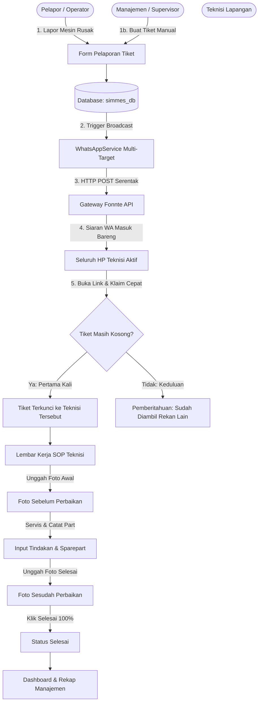

# SIMMES (Sistem Informasi Monitoring & Maintenance Mesin)

Aplikasi web berbasis **Laravel 11** yang dirancang untuk mengelola pemeliharaan mesin pabrik/industri, mencakup penanganan kerusakan (*Corrective Maintenance*), jadwal pemeliharaan rutin (*Preventive Maintenance*), manajemen aset mesin, penugasan teknisi dengan sistem **"Siapa Cepat Dia Dapat"**, serta integrasi notifikasi otomatis via **WhatsApp Gateway (Fonnte)**.

---

## Daftar Isi
1. [Arsitektur & Hak Akses Pengguna (Role)](#1-arsitektur--hak-akses-pengguna-role)
2. [Peta Struktur File & Keterhubungannya](#2-peta-struktur-file--keterhubungannya)
   - [A. Modul Teknisi (Mobile-First / Lapangan)](#a-modul-teknisi-mobile-first--lapangan)
   - [B. Modul Manajemen / Supervisor (Desktop & Tablet)](#b-modul-manajemen--supervisor-desktop--tablet)
   - [C. Modul Pelaporan Tiket & WhatsApp Gateway](#c-modul-pelaporan-tiket--whatsapp-gateway)
   - [D. Modul Autentikasi & Manajemen Akun](#d-modul-autentikasi--manajemen-akun)
3. [Alur Kerja Aplikasi (Application Workflows)](#3-alur-kerja-aplikasi-application-workflows)
   - [Workflow 1: Pelaporan Tiket & Siaran WA Serentak ("Siapa Cepat Dia Dapat")](#workflow-1-pelaporan-tiket--siaran-wa-serentak-siapa-cepat-dia-dapat)
   - [Workflow 2: Pengerjaan & Lembar Kerja Teknisi (SOP Foto Sebelum & Sesudah)](#workflow-2-pengerjaan--lembar-kerja-teknisi-sop-foto-sebelum--sesudah)
   - [Workflow 3: Pemeliharaan Rutin / Berkala (Preventive Maintenance)](#workflow-3-pemeliharaan-rutin--berkala-preventive-maintenance)
   - [Workflow 4: Monitoring KPI & Rekap Laporan Manajemen](#workflow-4-monitoring-kpi--rekap-laporan-manajemen)
4. [Diagram Alur Sistem (Mermaid)](#4-diagram-alur-sistem-mermaid)
5. [Skema Basis Data (Database Tables)](#5-skema-basis-data-database-tables)
6. [Panduan Instalasi & Menjalankan Aplikasi](#6-panduan-instalasi--menjalankan-aplikasi)

---

## 1. Arsitektur & Hak Akses Pengguna (Role)

Aplikasi memiliki 2 role utama dengan antarmuka yang disesuaikan secara khusus:

| Role | Antarmuka Pengguna | Fokus Penggunaan |
| :--- | :--- | :--- |
| **Teknisi** (`teknisi`) | Tampilan responsif **Mobile-First** (Bottom Navigation Bar, kartu kerja ringkas, modal kamera instan). | Menerima siaran tugas, klaim tiket secara mandiri (*first-come first-served*), unggah foto kondisi awal/akhir, catat pemakaian sparepart, dan selesaikan pekerjaan. |
| **Manajemen** (`manajemen`) | Tampilan **Desktop/Tablet Dashboard** (Sidebar kiri permanen, kartu KPI interaktif, segmented operational rooms, kalender maintenance, dan rekap print). | Memantau kesiapan mesin, membuat jadwal maintenance rutin, mengelola data mesin & pengguna, mengevaluasi tiket terlambat, dan mencetak laporan HRD/Direksi. |

---

## 2. Peta Struktur File & Keterhubungannya

### A. Modul Teknisi (Mobile-First / Lapangan)

Semua rute teknisi berada di bawah grup prefix `/teknisi` dengan middleware `auth` dan `role:teknisi`.

| Komponen | Lokasi File | Fungsi & Keterhubungan |
| :--- | :--- | :--- |
| **Routing** | `routes/simmes.php` (baris 74–108) | Mendefinisikan seluruh rute teknisi (`teknisi.home`, `teknisi.tugas.*`, `teknisi.jadwal.*`, `teknisi.laporan.*`, `teknisi.profil.*`). |
| **Layout Utama** | `resources/views/layouts/technician.blade.php` | Kerangka halaman ponsel teknisi, header status, bottom navigation (Home, Tugas, Jadwal, Laporan, Profil), listener audio notifikasi, dan auto-dismiss alert flash. |
| **Dashboard Teknisi** | Controller: `app/Http/Controllers/Teknisi/HomeController.php`<br>↳ `resources/views/teknisi/home.blade.php` | Menampilkan ringkasan tugas aktif, tiket tersedia untuk diklaim, status mesin terkini, serta polling JSON `/teknisi/live-alerts` untuk audio alert real-time. |
| **Daftar Tugas Teknisi** | Controller: `app/Http/Controllers/Teknisi/TaskController.php`<br>↳ `resources/views/teknisi/tugas/index.blade.php` | Daftar tugas teknisi dengan filter: Tugas Tersedia (Klaim), Belum Mulai, Sedang Dikerjakan, dan Selesai. |
| **Form Pengerjaan SOP Tugas** | Controller: `app/Http/Controllers/Teknisi/TaskController.php`<br>↳ `resources/views/teknisi/tugas/detail.blade.php`<br>*(alias: `form-pengerjaan.blade.php`)* | **Lembar kerja eksekusi perbaikan**: tombol klaim mandiri, upload foto *Sebelum Perbaikan*, input rincian tindakan perbaikan & suku cadang, upload foto *Sesudah Perbaikan*, dan tombol selesai 100%. |
| **Jadwal Rutin Teknisi** | Controller: `app/Http/Controllers/Teknisi/ScheduleController.php`<br>↳ `resources/views/teknisi/jadwal/index.blade.php` | Menampilkan agenda jadwal pemeliharaan preventif rutin mesin yang ditugaskan ke teknisi. |
| **Laporan Mandiri Teknisi** | Controller: `app/Http/Controllers/Teknisi/ReportController.php`<br>↳ `resources/views/teknisi/laporan/` (`index`, `create`, `edit`, `show`) | - `index.blade.php`: Riwayat laporan mandiri.<br>- `create.blade.php`: Form lapor kerusakan baru dari lapangan.<br>- `edit.blade.php`: Form edit laporan & kelola media.<br>- `show.blade.php`: Halaman detail laporan. |
| **Profil & Konfigurasi WA** | Controller: `app/Http/Controllers/Teknisi/ProfileController.php`<br>↳ `resources/views/teknisi/profil/index.blade.php` | Mengubah profil nama pengguna, memperbarui nomor WhatsApp, tombol uji coba pesan (*Tes Kirim WA*), dan logout. |

---

### B. Modul Manajemen / Supervisor (Desktop & Tablet)

Semua rute manajemen berada di bawah grup prefix `/manajemen` dengan middleware `auth` dan `role:manajemen`.

| Komponen | Lokasi File | Fungsi & Keterhubungan |
| :--- | :--- | :--- |
| **Routing** | `routes/simmes.php` (baris 19–72) | Mendefinisikan seluruh rute manajemen (`manajemen.dashboard`, `manajemen.mesin.*`, `manajemen.perbaikan.*`, `manajemen.jadwal.*`, `manajemen.laporan.*`, `manajemen.pengguna.*`). |
| **Layout Utama** | `resources/views/layouts/manager.blade.php` | Sidebar menu navigasi, identitas user login, header dinamis, dan modal quick-actions. |
| **Dashboard Manajemen** | Controller: `app/Http/Controllers/Manajemen/DashboardController.php`<br>↳ `resources/views/manajemen/dashboard.blade.php` | - 4 KPI Card interaktif (Mesin Aktif, Sedang Diperbaiki, Menunggu Teknisi, Melewati Batas Waktu).<br>- Segmented Operational Rooms: Tab Tiket Perbaikan, Tab Jadwal Mendatang, dan Tab Riwayat Selesai.<br>- Tombol pengujian langsung koneksi Gateway Fonnte (*Tes Gateway WA*). |
| **Data Mesin** | Controller: `app/Http/Controllers/Manajemen/MachineController.php`<br>↳ `resources/views/manajemen/mesin/` (`index`, `create`, `edit`, `form`, `show`) | - `index.blade.php`: Tabel daftar seluruh mesin & import CSV.<br>- `create.blade.php` / `edit.blade.php` / `form.blade.php`: Formulir input data mesin.<br>- `show.blade.php`: Detail mesin & riwayat perbaikan. |
| **Monitoring Perbaikan** | Controller: `app/Http/Controllers/Manajemen/TicketController.php`<br>↳ `resources/views/manajemen/perbaikan/` (`index`, `create`, `edit`, `show`) | - `index.blade.php`: Tabel seluruh tiket perbaikan masuk.<br>- `create.blade.php`: Form buat laporan perbaikan baru manajemen.<br>- `edit.blade.php`: Form edit tiket (urgensi, teknisi, status).<br>- `show.blade.php`: Detail tiket, foto sebelum/sesudah, linimasa. |
| **Jadwal Maintenance** | Controller: `app/Http/Controllers/Manajemen/ScheduleController.php`<br>↳ `resources/views/manajemen/jadwal/` (`index`, `kalender`, `create`, `edit`, `_tabs`) | - `index.blade.php`: Tabel antrean jadwal rutin.<br>- `kalender.blade.php`: Tampilan kalender bulanan interaktif.<br>- `create.blade.php`: Form buat jadwal pemeliharaan baru.<br>- `edit.blade.php`: Form edit jadwal pemeliharaan. |
| **Data Teknisi** | Controller: `app/Http/Controllers/Manajemen/TechnicianController.php`<br>↳ `resources/views/manajemen/teknisi/` (`index`, `create`, `show`) | - `index.blade.php`: Daftar seluruh teknisi & status WA.<br>- `create.blade.php`: Form pendaftaran teknisi baru.<br>- `show.blade.php`: Detail beban kerja tiket teknisi. |
| **Manajemen Pengguna** | Controller: `app/Http/Controllers/Manajemen/UserController.php`<br>↳ `resources/views/manajemen/pengguna/` (`index`, `create`, `edit`, `form`) | - `index.blade.php`: Tabel daftar pengguna & persetujuan akun.<br>- `create.blade.php` / `edit.blade.php`: Form penetapan peran (role) & data karyawan. |
| **Rekap Laporan (HRD)** | Controller: `app/Http/Controllers/Manajemen/ReportController.php`<br>↳ `resources/views/manajemen/laporan/index.blade.php` | Rekap laporan komprehensif penanganan mesin, filter tanggal, mesin, dan teknisi, serta tampilan khusus cetak (*print-friendly view*). |

---

### C. Modul Pelaporan Tiket & WhatsApp Gateway

| Komponen | Lokasi File | Fungsi & Keterhubungan |
| :--- | :--- | :--- |
| **Form Lapor Cepat** | `app/Http/Controllers/TicketReportController.php`<br>↳ `resources/views/tiket/lapor.blade.php`<br>↳ `resources/views/tiket/sukses.blade.php` | Form lapor kerusakan mesin dengan pemilihan mesin pintar (*picker/lookup*), input kendala, upload media (foto/video), dan penentuan tingkat urgensi. Setelah tiket tersimpan, memicu otomatis siaran serentak ke WA seluruh teknisi. |
| **WhatsApp Service Gateway** | `app/Services/WhatsAppService.php` | - Menghubungkan aplikasi ke API Fonnte (`https://api.fonnte.com/send`).<br>- Normalisasi format nomor internasional (`628...`).<br>- `broadcastToAllTechnicians()`: Mengirim siaran serentak multi-target (koma) ke seluruh teknisi aktif.<br>- `sendTicketAssignment()`: Kirim notifikasi penugasan tiket perorangan.<br>- `sendScheduleReminder()`: Pengingat agenda maintenance (H-7, H-1, Hari-H, Terlambat).<br>- `makeBroadcastShareLink()`: Link manual share WhatsApp Web / Grup WA. |
| **Automasi Pengingat CLI** | `app/Console/Commands/SendMaintenanceReminders.php`<br>↳ `routes/console.php` | Menjalankan scheduler harian (`simmes:reminders`) untuk memindai jadwal pemeliharaan dan mengirim notifikasi otomatis jika jadwal mendekati batas waktu. |

---

### D. Modul Autentikasi & Manajemen Akun

| Komponen | Lokasi File | Fungsi & Keterhubungan |
| :--- | :--- | :--- |
| **Splash Screen** | `resources/views/splash.blade.php` | Halaman selamat datang dengan pengalihan otomatis sesuai status sesi login pengguna. |
| **Login & Logout** | `app/Http/Controllers/Auth/LoginController.php`<br>↳ `resources/views/auth/login.blade.php` | Otentikasi NIK / Email dan Kata Sandi, proteksi *throttling* percobaan login gagal. |
| **Registrasi Pengguna** | `app/Http/Controllers/Auth/RegisterController.php`<br>↳ `resources/views/auth/register.blade.php` | Registrasi akun baru (memerlukan persetujuan Manajemen sebelum dapat login jika status `menunggu`). |
| **Home Redirect** | `app/Http/Controllers/HomeRedirectController.php`<br>↳ `app/Http/Controllers/DashboardController.php` | Mengarahkan user yang telah login otomatis ke `/manajemen` (jika role manajemen) atau `/teknisi` (jika role teknisi). |
| **Middleware Role & Status** | `app/Http/Middleware/CheckRole.php`<br>`app/Http/Middleware/EnsureAccountIsActive.php` | Memastikan hanya user berstatus aktif dan memiliki hak akses sesuai yang dapat membuka endpoint tertentu. |

---

## 3. Alur Kerja Aplikasi (Application Workflows)

### Workflow 1: Pelaporan Tiket & Siaran WA Serentak ("Siapa Cepat Dia Dapat")
```text
[Operator / Lapangan] ──> Buka Menu Lapor Kerusakan
                                │
                                ▼
                       Pilih Mesin & Unggah Bukti
                                │
                                ▼
                       Klik "Kirim Laporan"
                                │
               ┌────────────────┴────────────────┐
               ▼                                 ▼
      Data Tiket Disimpan            WhatsAppService Broadcast
      (Status: 'dilaporkan')         (Kirim serentak ke nomor seluruh
      (technician_id = null)          teknisi via Fonnte Gateway)
                                                 │
                                                 ▼
                                     Pesan Masuk ke HP Teknisi:
                                     "👉 Silakan buka website untuk
                                      mengambil tugas: [Link Tiket]"
```

1. Pelapor (Operator, Teknisi, atau Manajemen) mengisi form lapor kerusakan mesin di halaman `/manajemen/lapor` atau `/teknisi/laporan/buat`.
2. Sistem menyimpan tiket dengan status awal `dilaporkan` dan kolom `technician_id` kosong (`null`), yang menandakan tugas ini **terbuka untuk siapa saja**.
3. `WhatsAppService::broadcastToAllTechnicians()` dijalankan secara otomatis:
   - Mengambil seluruh nomor telepon teknisi aktif dari basis data.
   - Mengirimkan satu pesan siaran serentak melalui Fonnte dengan target multi-nomor:
     ```text
     🚨 SIMMES - PEMBERITAHUAN TIKET PERBAIKAN BARU
     (SISTEM: SIAPA CEPAT DIA DAPAT)

     No. Tiket    : TKT-202611-001
     Mesin Rusak  : Mesin Press 2
     Keluhan      : Suhu motor panas berlebih...

     👉 Silakan buka website untuk mengambil tugas:
     http://127.0.0.1:8000/teknisi/tugas/12
     ```
4. Pelapor diarahkan ke layar sukses ([`tiket/sukses.blade.php`](file:///c:/laragon/www/simmes-app/resources/views/tiket/sukses.blade.php)) yang menampilkan status apakah siaran WA berhasil dikirim atau gateway sedang offline.

---

### Workflow 2: Pengerjaan & Lembar Kerja Teknisi (SOP Foto Sebelum & Sesudah)
```text
[Teknisi di Lapangan] ──> Buka Tautan dari WhatsApp
                                │
                                ▼
                     Buka Lembar Kerja Tiket
                                │
                                ▼
                      Klik "Ambil Tugas Ini"
                                │
               ┌────────────────┴────────────────┐
               ▼                                 ▼
         Tiket Terkunci                 Tanpa Notifikasi
       (technician_id diisi              (Tidak membebani WA
        status: 'diproses')               dengan spam pesan)
               │
               ▼
   [SOP Tahap 1: Foto Sebelum] ──> Unggah kondisi mesin awal rusak
               │
               ▼
   [SOP Tahap 2: Eksekusi]     ──> Catat tindakan teknis & sparepart
               │
               ▼
   [SOP Tahap 3: Foto Sesudah] ──> Unggah bukti mesin kembali normal
               │
               ▼
   [SOP Tahap 4: Selesaikan]   ──> Klik "Tandai 100% Selesai"
                                   (Tiket & Mesin berstatus 'selesai')
```

1. Para teknisi menerima notifikasi WA secara bersamaan.
2. Siapa pun teknisi yang pertama membuka tautan dan menekan tombol **"Ambil Tugas Ini"**:
   - Tiket langsung ditetapkan kepada dirinya (`technician_id = auth()->id()`).
   - Status tiket berubah menjadi `diproses` dan status mesin menjadi `diproses`.
   - **Tidak ada notifikasi balasan/spam** yang dikirimkan saat klaim tiket berhasil.
   - Jika ada teknisi lain yang menekan tautan setelahnya, sistem menolak klaim dan menampilkan info bahwa tugas telah diambil oleh teknisi lain.
3. Teknisi menjalankan SOP pengerjaan pada halaman [`detail.blade.php`](file:///c:/laragon/www/simmes-app/resources/views/teknisi/detail.blade.php):
   - **Upload Foto Kondisi Awal (*Sebelum*)**: Wajib mendokumentasikan kerusakan visual awal.
   - **Catat Tindakan & Suku Cadang**: Memasukkan rincian penggantian bearing, seal, pelumasan, dll.
   - **Upload Foto Kondisi Akhir (*Sesudah*)**: Mendokumentasikan kondisi mesin yang telah pulih.
   - **Selesaikan Tugas**: Menekan tombol "Selesai 100%". Status tiket menjadi `selesai`, dan mesin kembali siap operasi (`aktif`).

---

### Workflow 3: Pemeliharaan Rutin / Berkala (Preventive Maintenance)
1. **Perencanaan oleh Manajemen**:
   - Manajemen membuka menu **Jadwal Maintenance** (`/manajemen/jadwal/baru`).
   - Memilih mesin target, tanggal jatuh tempo, jam pengerjaan, dan teknisi pelaksana.
2. **Pengingat Otomatis**:
   - Sistem CLI Scheduler (`simmes:reminders`) memindai jadwal setiap hari pukul 07:00 WIB.
   - Notifikasi WhatsApp dikirimkan ke teknisi pelaksana pada H-7, H-1, Hari-H, atau jika jadwal terlewat (*overdue*).
3. **Pengerjaan Jadwal**:
   - Teknisi dapat melihat agenda servis di menu **Jadwal** di aplikasi ponselnya.
   - Manajemen dapat mengonversi jadwal menjadi lembar tiket pengerjaan mandiri melalui tombol **"Buat Tiket Pengerjaan"**.
   - Setelah servis berkala tuntas, tanggal servis terakhir mesin (*last_service_at*) otomatis diperbarui.

---

### Workflow 4: Monitoring KPI & Rekap Laporan Manajemen
1. **Monitoring Real-Time di Dashboard Manajemen**:
   - 4 Kartu KPI menghitung secara otomatis: jumlah mesin aktif, mesin yang sedang dalam penanganan, laporan baru yang belum diambil teknisi, dan tiket yang melewati batas waktu (*overdue*).
   - Tab Room memudahkan supervisor berganti fokus antara tiket kerusakan aktif, jadwal pemeliharaan mendatang, dan riwayat pekerjaan yang sudah selesai.
2. **Evaluasi & Rekap HRD/Direksi**:
   - Melalui menu **Laporan** (`/manajemen/laporan`), pengelola dapat memfilter riwayat servis berdasarkan rentang tanggal, filter jenis mesin, atau filter teknisi spesifik.
   - Tersedia tombol **Cetak Laporan** yang langsung menyesuaikan tata letak halaman agar siap dicetak (*Print/PDF format*) lengkap dengan ringkasan biaya, suku cadang, dan durasi kerja.

---

## 4. Diagram Alur Sistem (Mermaid)



---

## 5. Skema Basis Data (Database Tables)

Aplikasi menggunakan basis data relasional MySQL (`simmes_db`) dengan tabel-tabel utama berikut:

```
users (Pengguna: id, nik, name, email, password, role, status, whatsapp, bagian, department)
  │
  ├──< tickets (Tiket: id, code, machine_id, reporter_id, technician_id, complaint, urgency, status, due_at, started_at, finished_at, action, spareparts)
  │      │
  │      ├──< ticket_media (Lampiran: id, ticket_id, phase [report/before/after], kind [photo/video], path)
  │      └──< ticket_logs  (Riwayat: id, ticket_id, user_id, action, note, created_at)
  │
  ├──< maintenance_schedules (Jadwal: id, machine_id, technician_id, ticket_id, title, due_date, due_time, status, interval_months, last_reminder_sent_at)
  │
machines (Aset Mesin: id, code, name, category, model_type, serial_number, location, purchase_date, last_service_at, status, service_interval_months)
```

- **`users`**: Menyimpan data akun login, role (`manajemen` atau `teknisi`), status verifikasi akun (`aktif`, `menunggu`, `nonaktif`), serta nomor WhatsApp aktif.
- **`machines`**: Menyimpan inventaris mesin, kode unik mesin (misal: `MSN-001`), lokasi fisik pabrik/lantai, status mesin saat ini (`aktif`, `dilaporkan`, `diproses`, `nonaktif`), dan riwayat tanggal servis.
- **`tickets`**: Tabel utama penanganan kerusakan mesin (*Corrective Action*). Berisi status progres (`dilaporkan`, `diproses`, `selesai`), tingkat urgensi (`rendah`, `sedang`, `tinggi`), catatan teknis tindakan perbaikan, dan suku cadang yang terpakai.
- **`ticket_media`**: Menyimpan path file foto atau video yang diunggah teknisi pada setiap fase (fase lapor kendala, fase *sebelum perbaikan*, dan fase *sesudah perbaikan*).
- **`ticket_logs`**: Mencatat *audit trail* linimasa tiket (kapan tiket dilaporkan, siapa yang mengklaim, kapan pengerjaan dimulai, dan kapan dinyatakan selesai).
- **`maintenance_schedules`**: Menyimpan jadwal pemeliharaan preventif berkala beserta pelacak waktu kirim notifikasi WhatsApp pengingat.

---

## 6. Panduan Instalasi & Menjalankan Aplikasi

### Kebutuhan Sistem
- **PHP** versi 8.2 atau lebih baru.
- **Composer** versi 2.x.
- **Node.js** & **NPM** (v18+).
- **MySQL / MariaDB** (dapat menggunakan paket Laragon / XAMPP).
- Akun dan Token Perangkat WhatsApp di [fonnte.com](https://fonnte.com).

### Langkah Instalasi
1. **Clone / Buka Repositori di Laragon**:
   ```bash
   cd c:\laragon\www\simmes-app
   ```
2. **Install Dependensi Composer & NPM**:
   ```bash
   composer install
   npm install && npm run build
   ```
3. **Konfigurasi Environment (`.env`)**:
   Salin `.env.example` ke `.env` dan sesuaikan kredensial database dan WhatsApp:
   ```env
   APP_NAME=SIMMES
   APP_URL=http://127.0.0.1:8000

   DB_CONNECTION=mysql
   DB_HOST=127.0.0.1
   DB_PORT=3306
   DB_DATABASE=simmes_db
   DB_USERNAME=root
   DB_PASSWORD=

   # Konfigurasi WhatsApp Gateway (Fonnte)
   FONNTE_TOKEN=TokenPerangkatAndaDiFonnte
   WA_TARGET_PHONE=081234567890
   ```
4. **Migrasi Database & Seeder**:
   ```bash
   php artisan migrate --seed
   ```
5. **Membuat Symlink Penyimpanan Media**:
   ```bash
   php artisan storage:link
   ```
6. **Menjalankan Server**:
   ```bash
   php artisan serve
   ```
   Akses aplikasi melalui peramban di: `http://127.0.0.1:8000`

---
*Dokumentasi ini disusun sebagai acuan teknis arsitektur, integrasi berkas, dan alur operasional Sistem Informasi Monitoring & Maintenance Mesin (SIMMES).*
