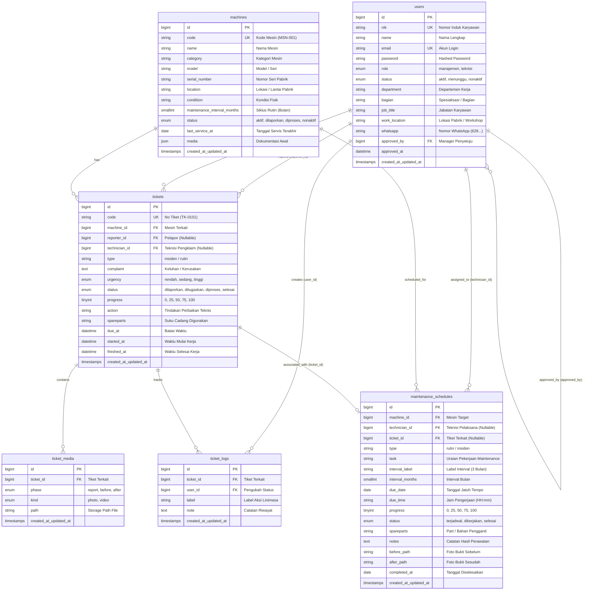
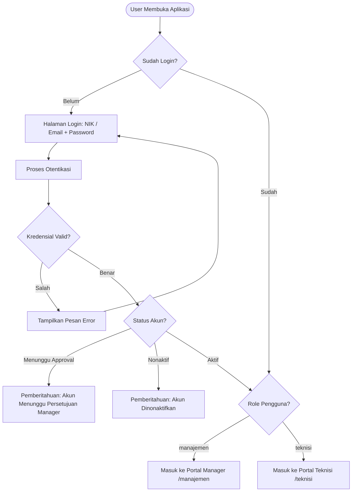
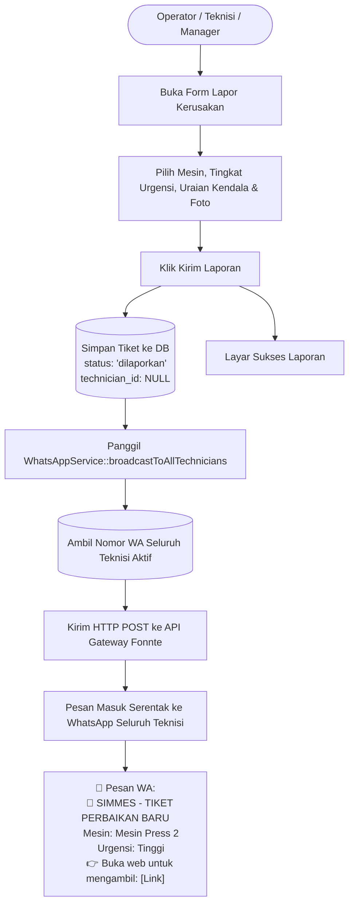

# SIMMES — Sistem Informasi Monitoring & Maintenance Mesin


**SIMMES** adalah aplikasi web modern berbasis industri manufaktur untuk memantau status aset mesin pabrik, menangani laporan perbaikan kerusakan (*Corrective Maintenance*), dan menjadwalkan pemeliharaan preventif berkala (*Preventive Maintenance*). 

Sistem ini dirancang khusus dengan dua pendekatan antarmuka: **Portal Manager Desktop** untuk manajemen/supervisor dan **Antarmuka Mobile-First** untuk teknisi di lapangan, terintegrasi langsung dengan **WhatsApp Gateway (Fonnte)** melalui sistem penugasan responsif **"Siapa Cepat Dia Dapat"** (*First-Come, First-Served*).

---

## 📌 Daftar Isi
1. [Latar Belakang & Nilai Tambah Aplikasi](#1-latar-belakang--nilai-tambah-aplikasi)
2. [Hak Akses Pengguna (Role & Permissions)](#2-hak-akses-pengguna-role--permissions)
3. [Entity Relationship Diagram (ERD)](#3-entity-relationship-diagram-erd)
4. [Struktur Arsitektur & Direktori Kode](#4-struktur-arsitektur--direktori-kode)
5. [Diagram Alur Sistem (System Flowcharts)](#5-diagram-alur-sistem-system-flowcharts)
   - [A. Alur Autentikasi & Role Gateway](#a-alur-autentikasi--role-gateway)
   - [B. Alur Laporan Insiden & Siaran WA ("Siapa Cepat Dia Dapat")](#b-alur-laporan-insiden--siaran-wa-siapa-cepat-dia-dapat)
   - [C. Alur Eksekusi SOP Perbaikan Teknisi (Foto Sebelum & Sesudah)](#c-alur-eksekusi-sop-perbaikan-teknisi-foto-sebelum--sesudah)
   - [D. Alur Preventive Maintenance & Penjadwalan Otomatis](#d-alur-preventive-maintenance--penjadwalan-otomatis)
6. [Skenario Demonstrasi untuk Presentasi](#6-skenario-demonstrasi-untuk-presentasi)
7. [Panduan Instalasi & Menjalankan Aplikasi](#7-panduan-instalasi--menjalankan-aplikasi)

---

## 1. Latar Belakang & Nilai Tambah Aplikasi

| Tantangan Konvensional Pabrik | Solusi & Inovasi SIMMES |
| :--- | :--- |
| **Downtime Mesin Lama**: Operator bingung harus melapor ke siapa, panggilan telepon sering terlewat. | **Siaran WhatsApp Otomatis**: Sekali lapor, bot otomatis menyiarkan detail kendala secara serentak ke WhatsApp seluruh teknisi aktif. |
| **Penugasan Tidak Adil / Bottleneck**: Supervisor repot membagi tugas manual satu per satu. | **Sistem Siapa Cepat Dia Dapat**: Teknisi pertama yang membuka link dan klik *Ambil Tugas* langsung memegang tiket. Tidak ada spam balasan. |
| **Ketiadaan Bukti Kerja Fisik**: Sulit membuktikan apakah mesin benar-benar diperbaiki atau hanya dicatat di atas kertas. | **SOP Wajib Foto Sebelum & Sesudah**: Sistem mewajibkan unggah bukti visual foto awal rusak dan foto akhir pemulihan mesin. |
| **Jadwal Servis Rutin Sering Terlewat**: Mesin tiba-tiba rusak total karena telat ganti oli atau bearing. | **Auto-Rescheduling & Reminders**: Scheduler harian memicu reminder WhatsApp (H-7, H-1, Hari-H, Terlambat). Saat selesai, siklus berikutnya otomatis terjadwal. |
| **UX Kaku di HP Teknisi**: Aplikasi web desktop biasa sulit dibuka lewat smartphone teknisi di lantai produksi. | **Mobile-First Touch UI**: Bottom navigation bar, modal popup timbul di tengah, floating action button, dan dialog konfirmasi kustom selaras brand. |

---

## 2. Hak Akses Pengguna (Role & Permissions)

```
                     ┌───────────────────────────┐
                     │   SIMMES Authentication   │
                     └─────────────┬─────────────┘
                                   │
                    ┌──────────────┴──────────────┐
                    ▼                             ▼
       ┌────────────────────────┐    ┌────────────────────────┐
       │   ROLE: MANAJEMEN      │    │    ROLE: TEKNISI       │
       │  (Desktop / Tablet)    │    │ (Mobile-First Screen)  │
       └────────────────────────┘    └────────────────────────┘
```

### A. Role Manajemen (`manajemen`)
* **Dashboard KPI**: Real-time counter (Mesin Aktif, Sedang Diperbaiki, Laporan Menunggu, Tiket Terlambat).
* **Manajemen Aset Mesin**: CRUD data mesin pabrik, import data massal CSV, cetak barcode/lookup code.
* **Jadwal Pemeliharaan**: Pembuatan agenda servis berkala, tampilan tabel & kalender bulanan.
* **Manajemen Teknisi & Akun**: Pendaftaran teknisi baru (modal cepat popup), persetujuan akun pending, monitoring beban kerja.
* **Rekapitulasi & Cetak Laporan (HRD / Direksi)**: Filter laporan per rentang tanggal, status, teknisi, dan cetak ramah kertas (*print-friendly view*).
* **WhatsApp Gateway Diagnostic**: Tombol uji koneksi dan tes kirim pesan API Fonnte.

### B. Role Teknisi (`teknisi`)
* **Beranda Responsif**: Notifikasi tiket terbuka (*floating hero*), statistik tugas perorangan, dan pengingat jadwal mendesak.
* **Klaim Tugas Lapangan**: Menerima tautan siaran WA, klaim tiket terbuka secara mandiri (*first-come first-served*).
* **Lembar Kerja SOP Teknisi**:
  1. *Fase 1*: Ambil tugas & unggah foto sebelum perbaikan.
  2. *Fase 2*: Tindakan teknis dan pencatatan suku cadang (*spare parts*).
  3. *Fase 3*: Unggah foto sesudah perbaikan.
  4. *Fase 4*: Konfirmasi selesai 100% dan update status mesin kembali aktif.
* **Pengerjaan Maintenance Modal Pop-up**: Eksekusi pemeliharaan rutin tanpa pindah halaman via modal tengah (*centered popup*), upload foto bukti sebelum/sesudah, dan integrasi tombol laporan instan ke WhatsApp Manajemen.
* **Lapor Kerusakan Mandiri**: Formulir cepat pelaporan kerusakan langsung dari area kerja lapangan.
* **Profil & Tes WhatsApp**: Uji mandiri nomor WhatsApp untuk memastikan nomor siap menerima siaran sistem.

---

## 3. Entity Relationship Diagram (ERD)

Berikut adalah relasi antar-tabel dalam basis data relasional `simmes_db`:



---

## 4. Struktur Arsitektur & Direktori Kode

Aplikasi dibangun mengikuti standar **Model-View-Controller (MVC)** Laravel dengan pemisahan domain yang rapi:

```
simmes-app/
├── app/
│   ├── Console/Commands/
│   │   └── SendMaintenanceReminders.php   # Cron CLI scheduler notifikasi pengingat
│   ├── Enums/
│   │   ├── AccountStatus.php              # Enum status akun (aktif, menunggu, nonaktif)
│   │   └── Role.php                       # Enum peran pengguna (manajemen, teknisi)
│   ├── Http/
│   │   ├── Controllers/
│   │   │   ├── Auth/                      # LoginController, RegisterController
│   │   │   ├── Manajemen/                 # Dashboard, Machine, Ticket, Schedule, Technician, User, Report
│   │   │   ├── Teknisi/                   # Home, Task, Schedule, Report, Profile
│   │   │   ├── DashboardController.php    # Router landing page
│   │   │   ├── HomeRedirectController.php # Redirection router sesuai role akun
│   │   │   └── TicketReportController.php # Form lapor insiden cepat & trigger WhatsApp
│   │   └── Middleware/
│   │       ├── CheckRole.php              # Proteksi prefix /manajemen & /teknisi
│   │       └── EnsureAccountIsActive.php  # Verifikasi status akun aktif sebelum akses
│   ├── Models/
│   │   ├── Concerns/HasSimmesRole.php     # Helper trait peran pengguna & initials
│   │   ├── Machine.php                    # Model aset mesin pabrik
│   │   ├── MaintenanceSchedule.php        # Model jadwal preventif berkala
│   │   ├── Ticket.php                     # Model tiket perbaikan insiden
│   │   ├── TicketLog.php                  # Model audit trail log aktivitas tiket
│   │   ├── TicketMedia.php                # Model foto bukti sebelum/sesudah
│   │   └── User.php                       # Model pengguna & autentikasi
│   └── Services/
│       └── WhatsAppService.php            # Service integrasi Fonnte Gateway (Broadcast & Direct WA)
├── database/
│   ├── migrations/                        # Skema database relasional
│   └── seeders/                           # Akun default manajemen, teknisi, dan mesin dummy
├── public/
│   ├── css/simmes.css                     # Desain sistem SIMMES (Palet warna crimson, badge, modal)
│   └── js/simmes.js                       # Skrip audio chiming, polling live alert, modal
├── resources/views/
│   ├── layouts/
│   │   ├── auth.blade.php                 # Layout halaman login & register
│   │   ├── manager.blade.php              # Layout portal desktop manager
│   │   └── technician.blade.php           # Layout antarmuka ponsel teknisi
│   ├── manajemen/                         # View folder modul manajemen
│   ├── teknisi/                           # View folder modul teknisi
│   ├── partials/
│   │   ├── confirm-modal.blade.php        # Modal konfirmasi kustom bertema crimson
│   │   ├── flash.blade.php                # Alert flash notification gradient
│   │   ├── icon.blade.php                 # SVG icon registry
│   │   └── quick-technician-modal.blade.php # Modal popup tambah teknisi cepat
│   └── tiket/                             # View lapor insiden & layar sukses
└── routes/
    ├── web.php                            # Root routing bootstrap
    ├── simmes.php                         # Definisi seluruh rute aplikasi (Prefix & Middleware)
    └── console.php                        # Jadwal tugas otomatis harian
```

---

## 5. Diagram Alur Sistem (System Flowcharts)

### A. Alur Autentikasi & Role Gateway
Diagram alur ketika pengguna mengakses sistem, login, dan diarahkan ke antarmukanya masing-masing:



---

### B. Alur Laporan Insiden & Siaran WA ("Siapa Cepat Dia Dapat")
Diagram pelaporan kerusakan mesin hingga tiket tersiar serentak ke WhatsApp para teknisi:



---

### C. Alur Eksekusi SOP Perbaikan Teknisi (Foto Sebelum & Sesudah)
Diagram pengerjaan di lapangan dengan sistem klaim mandiri tanpa spam:

```mermaid
flowchart TD
    TechGroup([Teknisi-Teknisi Menerima WA]) --> ClickLink[Buka Tautan Tiket di Ponsel]
    ClickLink --> CheckClaim{Apakah Tiket Masih Kosong?\ntechnician_id == NULL}

    CheckClaim -->|Sudah Diambil Orang Lain| Denied[Tampilkan Banner:\n'Tugas Sudah Diambil Rekan Lain']
    CheckClaim -->|Masih Kosong| ClaimBtn[Klik Tombol 'Ambil Tugas Ini']

    ClaimBtn --> LockTicket[(Update DB:\ntechnician_id = ID Teknisi\nstatus = 'diproses'\nMesin = 'diproses')]
    LockTicket --> Workdesk[Buka Lembar Pengerjaan SOP]

    Workdesk --> Phase1[Fase 1: Unggah Foto Kondisi Sebelum Perbaikan]
    Phase1 --> Phase2[Fase 2: Eksekusi Servis, Catat Tindakan & Suku Cadang]
    Phase2 --> Phase3[Fase 3: Unggah Foto Bukti Hasil Sesudah Perbaikan]
    Phase3 --> Phase4[Fase 4: Klik Tombol 'Tandai Selesai 100%']

    Phase4 --> CustomConfirm[Muncul Modal Konfirmasi Merah SIMMES]
    CustomConfirm -->|Setuju| FinalizeJob[(Update DB:\nstatus = 'selesai'\nfinished_at = now()\nMesin = 'aktif')]
    FinalizeJob --> Summary[Pekerjaan Tuntas & Masuk Rekap Laporan Manajemen]
```

---

### D. Alur Preventive Maintenance & Penjadwalan Otomatis
Diagram pemeliharaan berkala dengan pengingat otomatis dan perputaran siklus terjadwal:

```mermaid
flowchart TD
    Mgr([Manajemen]) --> CreateSchedule[Buat Jadwal Maintenance Baru\nMesin, Tugas, Tanggal, Jam, Teknisi]
    CreateSchedule --> SaveSchedule[(Tersimpan di maintenance_schedules\nstatus: 'terjadwal')]

    SaveSchedule --> DailyCron[Scheduler Harian Otomatis\nsimmes:reminders Pukul 07:00 WIB]
    DailyCron --> CheckDue{Evaluasi Batas Waktu}

    CheckDue -->|H-7 / H-1 / Hari-H| SendReminderWA[Kirim Notifikasi Pengingat ke WA Teknisi]
    CheckDue -->|Lewat Batas| SendLateWA[Kirim Notifikasi Keterlambatan Overdue]

    SendReminderWA --> TechExecution[Teknisi Membuka Jadwal di Aplikasi]
    SendLateWA --> TechExecution

    TechExecution --> OpenModal[Klik 'Kerjakan & Laporkan Hasil'\nModal Pop-up Timbul di Tengah Layar]
    OpenModal --> UploadProof[Unggah Foto Bukti Sebelum & Sesudah\nCatat Suku Cadang & Catatan Perawatan]
    OpenModal --> CompleteJob[Klik 'Tandai Selesai & Laporkan']

    CompleteJob --> UpdateMachine[(Update Mesin:\nlast_service_at = now()\nstatus = 'aktif')]
    CompleteJob --> AutoNextCycle{Memiliki Siklus Rutin?}
    AutoNextCycle -->|Ya: misal 3 bulan| NewSchedule[(Auto Create Jadwal Berikutnya\ndue_date = today + 3 bulan)]
    AutoNextCycle -->|Tidak| DoneFinish[Selesai & Tersimpan di Riwayat]
    CompleteJob --> ShareWAMgr[Tombol 1-Klik Kirim Laporan Selesai ke WA Manager]
```

---

## 6. Skenario Demonstrasi untuk Presentasi

Gunakan skenario berikut agar presentasi dan demonstrasi fitur berjalan runtut, interaktif, dan memukau para penguji/audiens:

```text
               SKENARIO DEMO PRESENTASI SIMMES (5 MENIT)
┌───────────────────────────────────────────────────────────────────────┐
│ 1. Pembuka (Portal Manager Desktop):                                  │
│    - Buka http://127.0.0.1:8000/login dengan akun Manajemen.          │
│    - Tunjukkan Dashboard KPI, status mesin aktif vs perbaikan.        │
│    - Tunjukkan fitur Popup Tambah Teknisi Cepat (Modal timbul tengah). │
│                                                                       │
│ 2. Simulasi Terjadinya Kerusakan Mesin:                               │
│    - Buka menu Lapor Kerusakan (/manajemen/lapor).                    │
│    - Pilih mesin "Mesin Press 2", pilih Urgensi Tinggi, upload foto.  │
│    - Klik Kirim Laporan: Tunjukkan status siaran WA serentak berhasil.│
│                                                                       │
│ 3. Respon Teknisi Lapangan (Sistem Siapa Cepat Dia Dapat):            │
│    - Login sebagai Teknisi A di tab incognito / mode ponsel (F12).    │
│    - Tunjukkan banner hero "⚡ TERBUKA - 1 Laporan Terbuka".          │
│    - Klik "Ambil Tugas": Tunjukkan tiket langsung terkunci.           │
│    - (Opsional) Buka akun Teknisi B: Perlihatkan bahwa Teknisi B      │
│      diberitahu bahwa tiket sudah diambil oleh Teknisi A.             │
│                                                                       │
│ 4. Eksekusi SOP Lapangan (Foto Bukti Sebelum & Sesudah):              │
│    - Di akun Teknisi A: Unggah foto Sebelum, input sparepart.         │
│    - Unggah foto Sesudah.                                             │
│    - Klik Selesai: Tunjukkan Dialog Konfirmasi Merah Khas SIMMES.     │
│    - Status tiket dan mesin kembali aktif 100%.                       │
│                                                                       │
│ 5. Demonstrasi Pemeliharaan Rutin (Preventive Maintenance):           │
│    - Buka menu Jadwal Perawatan di HP Teknisi.                        │
│    - Klik "Kerjakan & Laporkan Hasil": Form popup timbul di tengah.   │
│    - Selesaikan pekerjaan dan klik tombol "Kirim Laporan WA Manager". │
│                                                                       │
│ 6. Penutup (Rekap Laporan & Print View):                              │
│    - Kembali ke Portal Manajemen, buka menu Laporan.                  │
│    - Tunjukkan riwayat perbaikan yang baru selesai terekam otomatis.  │
│    - Klik "Cetak Laporan": Tunjukkan tampilan print resmi pabrik.     │
└───────────────────────────────────────────────────────────────────────┘
```

---

## 7. Panduan Instalasi & Menjalankan Aplikasi

### Kebutuhan Perangkat Lunak
* **PHP** `>= 8.2` (dengan ekstensi: `pdo_mysql`, `mbstring`, `fileinfo`, `openssl`).
* **Composer** `>= 2.x`.
* **MySQL** atau **MariaDB** (dapat menggunakan Laragon atau XAMPP).
* **Peramban Web Modern** (Google Chrome, Microsoft Edge, atau Safari).
* *(Opsional)* Akun dan Token Perangkat di [Fonnte WhatsApp Gateway](https://fonnte.com).

### Langkah-Langkah Menjalankan
1. **Buka Direktori Proyek**:
   ```bash
   cd c:\laragon\www\simmes-app
   ```
2. **Install Dependensi Composer**:
   ```bash
   composer install
   ```
3. **Konfigurasi Lingkungan (`.env`)**:
   Salin `.env.example` menjadi `.env` jika belum ada:
   ```bash
   cp .env.example .env
   php artisan key:generate
   ```
   Pastikan pengaturan database di `.env` sesuai:
   ```env
   APP_NAME="SIMMES"
   APP_ENV=local
   APP_DEBUG=true
   APP_URL=http://127.0.0.1:8000

   DB_CONNECTION=mysql
   DB_HOST=127.0.0.1
   DB_PORT=3306
   DB_DATABASE=simmes_db
   DB_USERNAME=root
   DB_PASSWORD=

   # WhatsApp Gateway Fonnte (Opsional untuk pengiriman pesan nyata)
   FONNTE_TOKEN=TOKEN_FONNTE_ANDA
   ```
4. **Migrasi Database & Data Awal (Seeder)**:
   ```bash
   php artisan migrate --seed
   ```
5. **Buat Symlink Penyimpanan File**:
   ```bash
   php artisan storage:link
   ```
6. **Jalankan Server Lokal**:
   ```bash
   php artisan serve
   ```
   Buka peramban pada alamat: `http://127.0.0.1:8000`

### Akun Demo Bawaan Seeder:
* **Akun Portal Manajemen**:
  * Email / NIK: `manager@simmes.com` / `MGR001`
  * Kata Sandi: `password`
* **Akun Teknisi Lapangan**:
  * Email / NIK: `teknisi@simmes.com` / `TEK001`
  * Kata Sandi: `password`

---
*Dokumentasi ini disusun sebagai acuan komprehensif arsitektur, basis data, dan skenario presentasi Sistem Informasi Monitoring & Maintenance Mesin (SIMMES).*
